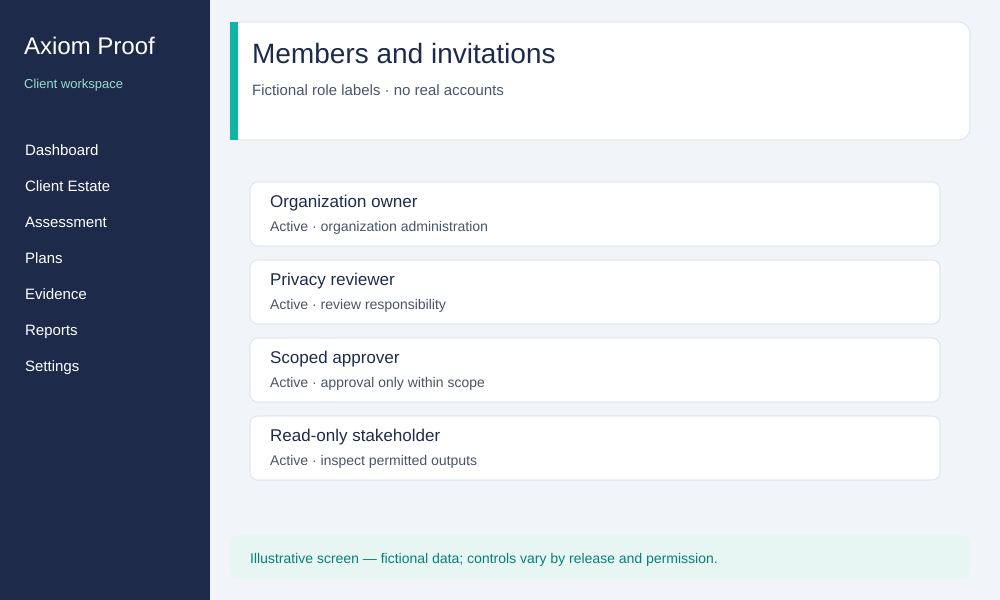

# Axiom Proof — Client Organization Help Manual

Audience: client organization owners, administrators, approvers, privacy
reviewers and viewers. This manual contains user-facing guidance and fictional
examples suitable for sharing with authorized client users.

## Contents

- [Getting started](#getting-started)
- [Roles and organization context](#roles-and-organization-context)
- [Sign-in, authenticator and invitations](#sign-in-authenticator-and-invitations)
- [Navigation and sample screens](#navigation-and-sample-screens)
- [Organization and estate setup](#organization-and-estate-setup)
- [Connections and public website review](#connections-and-public-website-review)
- [Discovery, classification and human review](#discovery-classification-and-human-review)
- [Assessments and remediation plans](#assessments-and-remediation-plans)
- [Approval, execution and rollback](#approval-execution-and-rollback)
- [Evidence, audit and reporting](#evidence-audit-and-reporting)
- [Rights, consent and incidents](#rights-consent-and-incidents)
- [Monitoring, regulatory changes and policies](#monitoring-regulatory-changes-and-policies)
- [Recommended role journeys](#recommended-role-journeys)
- [Troubleshooting and support](#troubleshooting-and-support)
- [Glossary](#glossary)

## Getting started

Use the product address supplied by your organization. Sign in with your own
invited identity, confirm the organization and complete any verification
prompt. Begin at [Dashboard](/dashboard). Do not treat a blank result, absent
integration or incomplete review as a passing compliance outcome.

This manual describes screens and role-eligible tasks, with limitations where
workflows are still being completed. It is not an assurance that every planned
feature is enabled in your release. Follow the page's availability notices.
For example, a Data Map label is not a completed processing register; a saved
connector is not proof it can reach a private system; a draft is not released
proof. Ask your organization administrator about the selected release.

**Aurora Textiles** and all records shown in sample illustrations are
fictional. The illustrations explain navigation and concepts; they are not
screenshots of a live client or evidence of a successful workflow.

## Roles and organization context

| Role / business responsibility                      | Typical permitted work                                                                                                        | Important limit                                                                             |
| --------------------------------------------------- | ----------------------------------------------------------------------------------------------------------------------------- | ------------------------------------------------------------------------------------------- |
| Organization owner                                  | Organization setup, members, permitted assessments/plans, scoped approval and enabled execution, evidence and working reports | Authority is within the selected organization; review/verification requirements still apply |
| Administrator                                       | Operational setup, members, permitted assessment/planning, approval and enabled execution                                     | Some commercial or restricted release operations require other authority                    |
| Approver                                            | Read findings/plans, comment, approve/reject within assigned scope, request an organization emergency stop                    | Cannot create a plan or execute it just because approval is permitted                       |
| Reviewer / designated privacy or DPO responsibility | Review permitted findings and observations, comment on plans and participate in assessment work                               | Business title does not automatically grant approval, execution or member management        |
| Viewer / read-only stakeholder                      | Read permitted posture, plans, reports, evidence and audit history                                                            | No modifying, approving, invoking or executing actions                                      |

A DPO, legal lead, auditor or executive is a business responsibility, not a
separate automatic permission. Your organization must assign an appropriate
supported role and scope. The reference at the end is generated from current
role eligibility; actual assignment, review scope and release readiness still
apply. Do not share credentials to work around a missing permission.

If you belong to several organizations, select the intended one before every
job. Being an owner in one does not make you an owner in another. After
switching, confirm the organization name and that the visible actions match
that membership.

## Sign-in, authenticator and invitations

### Sign in and maintain personal security

1. Open [Sign in](/login), enter your own credentials and submit once.
2. Complete a verification prompt with the authenticator enrolled for that
   same account. A previous account's authenticator does not verify a new one.
3. Confirm the dashboard appears and shows the intended organization.
4. Open Settings → [Security](/settings/security). If no factor is active,
   follow the enrollment action, register it in your authenticator, submit a
   current code and keep the displayed recovery codes privately.
5. For a replacement/revocation, use the current code or valid recovery code
   when the screen requests it. If neither works, stop and seek supported
   recovery; do not repeatedly replace factors or borrow another user's code.
6. Sign out on shared devices; do not export account secrets in a support log.

**Expected result:** usable sign-in without a manual refresh and successful
account-specific verification. Invalid or inaccessible factors must not be
silently bypassed. Save recovery codes only in your approved private storage.

### Manage and accept invitations

1. An authorized owner/admin opens Settings → [Members](/settings/members).
2. Enter a synthetic or intended invited address and the role actually
   required; review the scope before creating the invitation.
3. When delivery is disabled, privately share the displayed one-time link
   through an approved channel. Disabled email is not proof of inbox delivery.
4. The invitee opens a separate browser profile and signs up through
   [Sign up](/login?mode=signup), or signs in, with the exact invited address.
5. Open the link in that identity's session, accept and confirm the selected
   organization. Reload to check the membership remains accepted.
6. If the invitation is expired/revoked or the account is different, ask the
   inviter to review it. Do not publish the link in a screenshot or a ticket.

**Expected result:** membership for the invited identity in the intended
organization, with a persistent accepted state. The wrong identity is refused.
Missing member-edit, role-change or removal controls must not be inferred from
an invitation form; contact the administrator about supported operations.

## Navigation and sample screens

The left navigation groups work by discovery, assessment, remediation,
evidence, rights/consent, incidents, monitoring, reporting and operations.
Use the organization selector before opening an engagement. Settings contains
personal Security and, for authorized administrators, Members.

At a narrow screen width, use the navigation control to open the sidebar,
then return to the content. Keyboard users should be able to reach navigation,
forms, expanded details and errors in a logical order. Report clipped content,
missing focus, messages above the header or inconsistent page margins.

## Organization and estate setup

1. As an entitled owner/admin, open Client Estate → [Setup](/estate/setup).
2. Confirm the organization and its approved engagement scope.
3. Complete the displayed required information; do not guess system owners,
   processing purposes, retention or locations to satisfy a field.
4. Review the summary and perform the offered organization/setup action.
5. Reopen [Client Estate](/estate) and the engagement to confirm the saved
   context. Use [Estate Graph](/estate/graph) where available to inspect links.

**Expected result:** the intended organization/estate is recorded and survives
reload, with unknown facts explicitly unresolved. If “onboarding prerequisites
are not satisfied” appears, check the indicated verification/entitlement or
ask the administrator to investigate. Repeated clicking cannot create the
missing prerequisite. An unassigned engagement must not be silently attached
to a guessed estate.

## Connections and public website review

1. An authorized administrator opens [Connectors](/connectors).
2. For a public site, enter the approved public address and run the offered
   public website check. A fictional training site or an explicitly authorized
   organization site is appropriate for testing.
3. Inspect the recorded public pages, content and bounded form details.
4. Reopen the saved result to confirm it belongs to the intended organization
   and retains its source and time.
5. For a private connection, review what the screen says is configured and
   what is still missing. Arrange authorized access with your administrator
   and product support before expecting a live check.

**Expected result:** actual saved public information or a truthful refusal.
Public HTML does not prove private access, a functioning integration, personal
information storage or a finished assessment. “Private system connector
execution is not yet available” describes a different limitation from the
public website check. Registered options are not validated connections.

## Discovery, classification and human review

### Read observations

1. Open [Data Discovery](/discovery) or [Classification](/classification).
2. Select the correct organization/engagement and available saved source.
3. Read the source, captured time, recorded result and unresolved review.
4. Expand public page/form details where offered; reload and confirm the same
   retained observation can be found again.

**Expected result:** source-linked results with explicit unknowns. A public
website result cannot determine sensitive categories, backend processing or
retention by inference alone.

### Source-agent workflow — only when supplied in your release

A dedicated source workflow is being added in stages. It is not available in
all installations of the earlier local release.

1. Select an engagement and saved check, then review the source preview.
2. Bind that exact source using the offered action.
3. Request the enabled Discovery work; wait for its retained result.
4. Select that saved Discovery observation as Classification's input.
5. Read both results and their history. If a response is lost, use the displayed
   recovery action before starting new work; do not repeat an uncertain request.

**Expected result:** retained observations linked to the chosen source and to
each other, without duplicate work after recovery. A read-only user can inspect
permitted results but cannot request agent work.

### Human structural review — candidate until release clearance

When the review feature is enabled, an authorized reviewer selects the whole
observation or one exact recorded indicator, acknowledges or disputes it and
supplies a meaningful reason. A correction is a new judgment linked to the
current one; previous judgments remain visible. Confirm it after reload.

If the outcome is uncertain, reconcile the original request as directed by
the screen. Do not discard uncertainty or submit a different decision merely
to make the page look complete. An acknowledgment does not establish private
processing facts or automatically complete the assessment. Ask support if
these review controls are absent; they are still being completed.

Data Map & RoPA is a separate processing-register workflow. A placeholder is
not a generated register. Privacy notice/document review and delivery-task
workflows are also distinct; they must not be inferred from Classification or
Standing Policies.

## Assessments and remediation plans

1. Open [Engagements](/engagements), select the intended scope and read its status.
2. Open [Assessment](/assessment) and inspect the available findings.
3. Use [Control Library](/controls) to read the cited obligation and version
   associated with the assessment.
4. Open [Remediation Plans](/plans); read each action, its risk, affected scope,
   dependency, proposed change and rollback information.
5. Where your role supports it, comment on a plan or prepare supported work.
   Keep missing facts and unsupported actions explicit.

**Expected result:** findings and a plan traceable to the correct scope. A plan
must provide the required preview and rollback information before approval.
A numeric posture score or an agent label alone does not validate a conclusion.
Unsupported assessment/planning composition must be reported as unavailable,
not substituted with a manually fabricated “completed” result.

## Approval, execution and rollback

### Approver

1. Open [Approval Queue](/approval) and select a readable pending plan.
2. Inspect the proposed action, affected systems/records, risk, successful
   dry-run preview and validated rollback information.
3. Confirm your assigned approval scope includes that action. Complete any
   fresh verification prompt.
4. Approve only the intended subset, or reject with the required reason.
5. Reload and confirm the recorded decision and exact approved subset.

**Expected result:** a recorded scoped decision. Approval must be refused when
its prerequisites are incomplete; approving a subset must not authorize the
other actions. The approver role does not execute work.

### Authorized executor / administrator

1. Open [Execution & Rollback](/execution) only if your role offers it.
2. Confirm the intended approved subset and that a live target is enabled.
3. Request the offered execution once. Follow status; preserve any unknown or
   unconfirmed outcome for the displayed reconciliation procedure.
4. Inspect verification and retained evidence after completion.
5. Use an available approved rollback only within the authorized scope. An
   emergency stop is distinct from rollback and from releasing that stop.

**Expected result:** only approved enabled actions execute, with a recorded
outcome and verification. The product's private production execution path is
not cleared merely because this screen exists. If it is unavailable, stop and
seek configuration/release review; do not retry against a different target.

A blast-radius breach or emergency stop must halt work as specified. Releasing
an organization stop requires its separate authority. The technical-review
subscreen may be restricted to designated reviewers; client access must not
be assumed from a link.

## Evidence, audit and reporting

### Evidence and audit history

1. Open [Evidence Explorer](/evidence), select the permitted scope and inspect
   the artifact's source, state and retention information.
2. Download/export only through an offered permitted action.
3. Use [Audit Ledger](/ledger) to inspect the recorded finding, decision,
   execution and verification history where available.

**Expected result:** readable retained evidence and an explainable history.
A working attachment is not automatically sealed proof. Do not delete history
or assume a download grants permission to share personal information.

### Reports and proof dossiers

1. Open [Working Reports & Registers](/reports), select the intended engagement
   and supported type, and request generation if your role has that action.
2. Review scope, sources, incomplete facts and document state before export.
3. If your organization role provides it, open
   [Statutory Proof Dossiers](/reports?tab=pramaan) and select a supported dossier.
4. Follow the displayed review/release requirements. Some decisions belong to
   a separately authorized product reviewer; an organization owner cannot
   substitute their own decision where that authority is required.
5. Confirm a permitted export retrieves the intended retained version. Share
   only through an approved destination/workflow.

**Expected result:** a correct working report or separately released retained
proof artifact. A draft PDF, a preview, a sealed object and an authorized
release are distinct. Unsupported dossier types remain unavailable. Approval
reconciliation proof must explain the approved work and its recorded outcome;
it is not a substitute for the client's own review.

## Rights, consent and incidents

| Area                           | Steps                                                                                                                                    | Expected result and limitation                                                                                                        |
| ------------------------------ | ---------------------------------------------------------------------------------------------------------------------------------------- | ------------------------------------------------------------------------------------------------------------------------------------- |
| [DSAR / Rights](/dsars)        | Select the relevant request; review identity-verification, scope, status and due date; perform only the available authorized next action | A retained scoped request and truthful status. A displayed timer does not prove fulfillment or identity verification                  |
| [Consent Manager](/consent)    | Read purposes, consent/withdrawal status and available record history; use supported authorized actions only                             | A recorded change or explicit unavailability. Never interpret a static screen as a deployed website consent integration               |
| [Breach & Incident](/breaches) | Review/create an incident only through an offered authorized action; confirm affected scope, next duty, review and notification status   | A real scoped incident with unresolved duties visible. A draft notification is not proof it reached a regulator or an affected person |
| Incident review details        | Follow a review link only if your role is permitted                                                                                      | Restricted review decisions remain restricted; missing permission is not bypassed by a direct address                                 |

For urgent incidents, follow your organization's incident process immediately.
The application does not replace its duty to verify facts, legal applicability,
notification recipients and deadlines. Keep sensitive request/incident details
out of ordinary support screenshots.

## Monitoring, regulatory changes and policies

1. In [Continuous Monitoring](/monitoring), review recorded health/drift and
   open alerts. Inspect the source and timestamp before treating a status as
   current; configuration and scheduling may still need to be completed.
2. In [Regulatory Watch](/regwatch), review source changes, cited material and
   affected work. A new watch item is not automatic acceptance of a legal
   interpretation or proof that remediation occurred.
3. As an authorized administrator, open [Standing Policies](/policies) and
   review the actual offered controls. This page concerns standing operational
   policies; it is not the privacy-notice or document-generation workspace.
4. Use [Client Portal](/portal) for the permitted client-facing overview,
   pending decisions and readable outputs.

**Expected result:** current recorded results and explicit pending work. Do
not assume alerts were delivered or background checks executed from a card
alone. A standing policy does not grant blanket authority for unreviewed or
out-of-scope changes.

## Recommended role journeys

| Role                | Suggested daily sequence                                                                                                                                 | Validate before finishing                                                       |
| ------------------- | -------------------------------------------------------------------------------------------------------------------------------------------------------- | ------------------------------------------------------------------------------- |
| Owner/admin         | Correct organization → Dashboard → Members/Security as needed → Estate/Connectors → Engagement → Findings/Plans → permitted decisions → Reports/Evidence | Saved configuration and decisions; unresolved prerequisites remain explicit     |
| Privacy reviewer    | Engagement → Discovery/Classification → Assessment/Controls → plan comments → supported document/review queue                                            | Source facts and reasons, retained history, no unintended approval or execution |
| Approver            | Approval Queue → action preview/rollback/scope → fresh verification → precise subset decision                                                            | Decision persists and other actions remain unapproved                           |
| Authorized executor | Approved plan → enabled execution → status/reconciliation → verification/evidence                                                                        | Correct target/subset, recorded result and no duplicate work                    |
| Viewer              | Dashboard/Portal → readable engagement/findings/plans → reports/evidence/history                                                                         | Correct organization; no modifying action is offered or accepted                |

## Troubleshooting and support

| Message / symptom                        | Check and next action                                                                                     | Successful resolution                                                |
| ---------------------------------------- | --------------------------------------------------------------------------------------------------------- | -------------------------------------------------------------------- |
| Organization prerequisites not satisfied | Correct organization, entitlement and own verification; ask an administrator for the missing prerequisite | Setup completes through the supported flow, not a bypass             |
| Blank page after sign-in                 | Record route/time; try a normal fresh sign-in once; report if it persists                                 | Dashboard appears without manual refresh                             |
| Authenticator code not accepted          | Correct identity/factor, device time and supported recovery                                               | Valid verification or supported account recovery                     |
| Invitation acceptance fails              | Exact invited address, separate session, expiry/revocation                                                | Correct membership persists after reload                             |
| Public result has unknown facts          | Separate public content from private-system facts                                                         | Unknowns remain explicit until authorized review establishes them    |
| Private connection unavailable           | Descriptor, access grant and feature availability must all be reviewed                                    | Actual authorized check or a truthful pending prerequisite           |
| Pending/uncertain request                | Use displayed recovery before any retry                                                                   | One retained result, no accidental duplicate                         |
| Review or source changed                 | Refresh through the supported review procedure and inspect current state                                  | New decision based on the current source; previous history preserved |
| Report unavailable or incomplete         | Correct engagement/type/source/release state                                                              | Supported complete artifact or an explained limitation               |
| Notification not received                | Confirm delivery mode with administrator and provider outcome                                             | Actual inbox arrival separately from a saved local request           |
| Mobile clipping / misplaced notice       | Record route, viewport and keyboard steps                                                                 | Readable content, consistent header and usable focus                 |

Send support the displayed release label when available, role, organization
alias, route, reproduction steps, sanitized message and expected result.
Provide an approved record reference if needed. Do not send passwords,
authenticator/recovery codes, invitation tokens, other-client records or raw
session recordings. A workaround does not mean the underlying defect is fixed.

## Glossary

- **Organization:** the selected company context and its role assignments.
- **Estate:** systems or sites included in a reviewed work scope.
- **Engagement:** one scoped assessment/delivery effort.
- **Observation:** retained information from a particular source.
- **Finding:** a scoped issue supported by the recorded assessment.
- **Dry-run:** preview of the proposed action before authorization.
- **Rollback:** a reviewed method to reverse a supported change.
- **Review:** a human judgment; it does not by itself grant execution.
- **Working report:** a document still subject to its review/release rules.
- **Released proof:** a separately authorized retained proof artifact.
- **Unknown/unavailable:** missing evidence or missing capability, not success.

<!-- BEGIN GENERATED HELP REFERENCE -->

## Generated navigation and role reference

This reference lists role eligibility, not a grant of access or a promise that every
feature is enabled. Your selected organization, assignment, review scope and
release readiness still apply. A missing action must be investigated, not bypassed.

| Navigation label            | Location               | Eligible roles in this manual            |
| --------------------------- | ---------------------- | ---------------------------------------- |
| Dashboard                   | `/dashboard`           | owner, admin, approver, reviewer, viewer |
| Client Estate               | `/estate`              | owner, admin, approver, reviewer, viewer |
| Data Discovery              | `/discovery`           | owner, admin, approver, reviewer, viewer |
| Classification              | `/classification`      | owner, admin, approver, reviewer, viewer |
| Data Map & RoPA             | `/datamap`             | owner, admin, approver, reviewer, viewer |
| Assessment                  | `/assessment`          | owner, admin, approver, reviewer, viewer |
| Engagements                 | `/engagements`         | owner, admin, approver, reviewer, viewer |
| Control Library             | `/controls`            | owner, admin, approver, reviewer, viewer |
| Remediation Plans           | `/plans`               | owner, admin, approver, reviewer, viewer |
| Approval Queue              | `/approval`            | owner, admin, approver, reviewer, viewer |
| Execution & Rollback        | `/execution`           | owner, admin                             |
| Evidence Explorer           | `/evidence`            | owner, admin, approver, reviewer, viewer |
| Audit Ledger                | `/ledger`              | owner, admin, approver, reviewer, viewer |
| DSAR / Rights               | `/dsars`               | owner, admin, approver, reviewer, viewer |
| Consent Manager             | `/consent`             | owner, admin, approver, reviewer, viewer |
| Breach & Incident           | `/breaches`            | owner, admin, approver, reviewer, viewer |
| Continuous Monitoring       | `/monitoring`          | owner, admin, approver, reviewer, viewer |
| Regulatory Watch            | `/regwatch`            | owner, admin, approver, reviewer, viewer |
| Working Reports & Registers | `/reports`             | owner, admin, approver, reviewer, viewer |
| Statutory Proof Dossiers    | `/reports?tab=pramaan` | owner, admin                             |
| Connectors                  | `/connectors`          | owner, admin                             |
| Standing Policies           | `/policies`            | owner, admin                             |
| Settings                    | `/settings`            | owner, admin, approver, reviewer, viewer |

| Action                                    | owner                      | admin                      | approver                   | reviewer                   | viewer                     |
| ----------------------------------------- | -------------------------- | -------------------------- | -------------------------- | -------------------------- | -------------------------- |
| Read organization posture                 | Eligible; conditions apply | Eligible; conditions apply | Eligible; conditions apply | Eligible; conditions apply | Eligible; conditions apply |
| Create engagements                        | Eligible; conditions apply | Eligible; conditions apply | Not granted by this role   | Eligible; conditions apply | Not granted by this role   |
| Manage organization estate                | Eligible; conditions apply | Eligible; conditions apply | Not granted by this role   | Not granted by this role   | Not granted by this role   |
| Manage members and invitations            | Eligible; conditions apply | Eligible; conditions apply | Not granted by this role   | Not granted by this role   | Not granted by this role   |
| Change organization settings              | Eligible; conditions apply | Eligible; conditions apply | Not granted by this role   | Not granted by this role   | Not granted by this role   |
| Review or run permitted assessment work   | Eligible; conditions apply | Eligible; conditions apply | Not granted by this role   | Eligible; conditions apply | Not granted by this role   |
| Request enabled agent work                | Eligible; conditions apply | Eligible; conditions apply | Not granted by this role   | Not granted by this role   | Not granted by this role   |
| Prepare remediation plans                 | Eligible; conditions apply | Eligible; conditions apply | Not granted by this role   | Not granted by this role   | Not granted by this role   |
| Comment on readable plans                 | Eligible; conditions apply | Eligible; conditions apply | Eligible; conditions apply | Eligible; conditions apply | Not granted by this role   |
| Approve within assigned scope             | Eligible; conditions apply | Eligible; conditions apply | Eligible; conditions apply | Not granted by this role   | Not granted by this role   |
| Reject plans                              | Eligible; conditions apply | Eligible; conditions apply | Eligible; conditions apply | Not granted by this role   | Not granted by this role   |
| Execute authorized enabled actions        | Eligible; conditions apply | Eligible; conditions apply | Not granted by this role   | Not granted by this role   | Not granted by this role   |
| Resolve unconfirmed executions            | Eligible; conditions apply | Not granted by this role   | Not granted by this role   | Not granted by this role   | Not granted by this role   |
| Request an organization emergency stop    | Eligible; conditions apply | Eligible; conditions apply | Eligible; conditions apply | Not granted by this role   | Not granted by this role   |
| Release an organization emergency stop    | Eligible; conditions apply | Not granted by this role   | Not granted by this role   | Not granted by this role   | Not granted by this role   |
| Request supported working reports         | Eligible; conditions apply | Eligible; conditions apply | Not granted by this role   | Not granted by this role   | Not granted by this role   |
| Review restricted report releases         | Not granted by this role   | Not granted by this role   | Not granted by this role   | Not granted by this role   | Not granted by this role   |
| Release restricted reports                | Not granted by this role   | Not granted by this role   | Not granted by this role   | Not granted by this role   | Not granted by this role   |
| Record authorized evidence                | Eligible; conditions apply | Eligible; conditions apply | Not granted by this role   | Not granted by this role   | Not granted by this role   |
| Export permitted evidence                 | Eligible; conditions apply | Eligible; conditions apply | Not granted by this role   | Not granted by this role   | Not granted by this role   |
| Read the audit history                    | Eligible; conditions apply | Eligible; conditions apply | Eligible; conditions apply | Eligible; conditions apply | Eligible; conditions apply |
| Manage organization billing where enabled | Eligible; conditions apply | Not granted by this role   | Not granted by this role   | Not granted by this role   | Not granted by this role   |

Personal sign-in and security settings remain subject to account state.
Reports that require a separate release or permission are not made available by this table.
<!-- END GENERATED HELP REFERENCE -->
