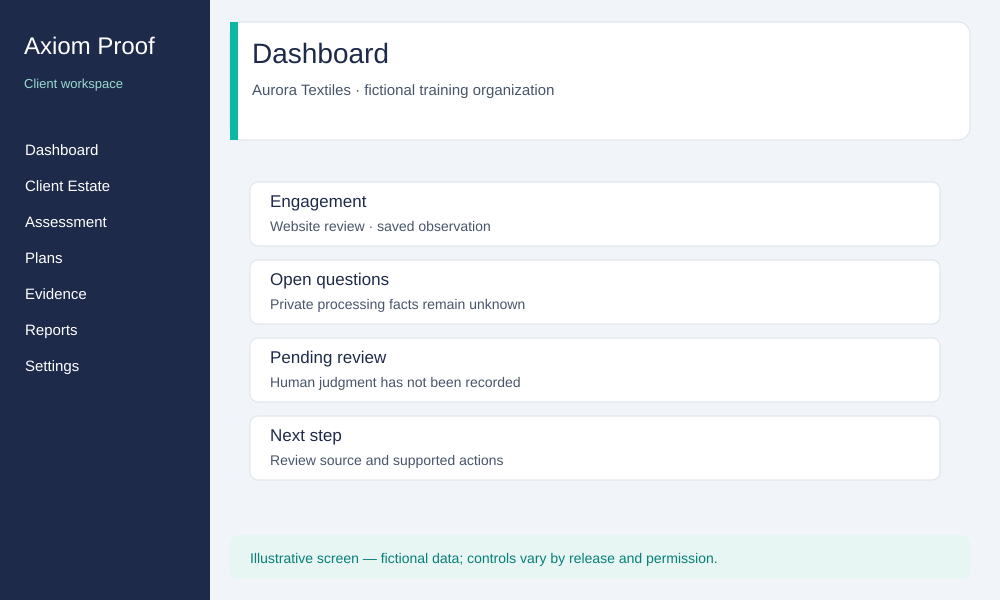
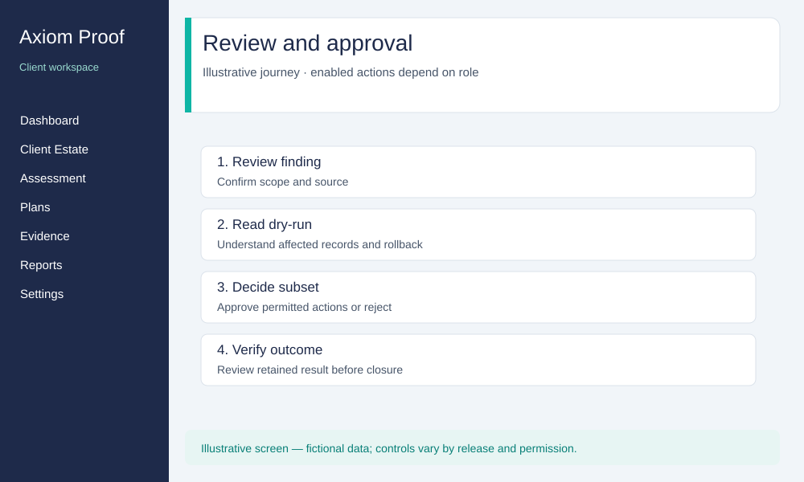

# Axiom Proof — Partner / Channel Partner Help Manual

Audience: authorized partner and channel-partner users. Share this manual with
partners; it contains product guidance and fictional examples only.

## Contents

- [Start here](#start-here)
- [Sign-in and account security](#sign-in-and-account-security)
- [Your client portfolio](#your-client-portfolio)
- [Review a client engagement](#review-a-client-engagement)
- [Reports and evidence](#reports-and-evidence)
- [Working with the client team](#working-with-the-client-team)
- [Module navigation](#module-navigation)
- [Common problems](#common-problems)
- [Safe sharing and support](#safe-sharing-and-support)
- [Glossary](#glossary)

## Start here

Use the product address supplied in your onboarding message. Sign in with your
own invited identity. Your partner role provides access only to authorized
client assignments. It does not grant the client's approval, execution or
member-administration permissions. If you hold another role for an organization,
its permissions apply only after selecting that organization.

A visible navigation label does not promise that a workflow is available in
your release. Check the notice on the page. Working report, retained evidence,
reviewed result and released dossier are different states. Do not present a
working document or an unavailable feature as an accepted compliance outcome.

The fictional organization in this manual is **Aurora Textiles**. All sample
screens are illustrations, not live screenshots or proof of enabled features.

## Sign-in and account security

1. Open [Sign in](/login) and use the exact invited address.
2. Complete the verification prompt using your own authenticator if requested.
3. Confirm the organization shown before reviewing any client record.
4. Open Settings → [Security](/settings/security) for personal security controls.
   When enrollment is offered, follow the displayed authenticator setup, enter
   a current code and save the one-time recovery codes privately.
5. Sign out on shared devices. Use separate browser profiles for separate test
   identities; do not swap authenticator codes between accounts.

**Expected result:** a populated permitted workspace and account-specific
security controls. An invalid verification code remains rejected. If an
existing authenticator is inaccessible, use its supported recovery flow or
contact your account administrator; never borrow a client's code.

For an invitation, open the one-time link privately in a session signed in as
the exact invited identity. If it says the account is different, sign out and
use the correct identity. Expired/revoked invitations need a new invitation;
refreshing the page cannot restore permission.

## Your client portfolio

1. Open [Partner Portal](/partner).
2. Review only the clients assigned to your organization/account.
3. Select the client context using the organization selector when available.
4. Confirm the client name before opening posture, engagements or a report.
5. Return to the portfolio to continue with another authorized client.

**Expected result:** the selected client's permitted records. A portfolio may
be empty until assignments exist. Missing controls for branding, referral
management, white-label setup or billing do not mean permission to change the
client's Settings; ask your partner contact which features are enabled.

Never assume one client's permission applies to another. If the product
refuses an unassigned client or a direct link, keep the refusal and request a
review of the assignment.

## Review a client engagement

1. Confirm the selected organization, then open [Dashboard](/dashboard).
2. Read the scope and date behind each available result. An empty score or
   unavailable result is not a passing assessment.
3. Open [Engagements](/engagements), select the intended engagement and inspect
   its recorded estate and status. Do not infer an unassigned estate.
4. Read [Assessment](/assessment), [Control Library](/controls), Discovery and
   Classification where available to your role.
5. Review [Remediation Plans](/plans) and [Approval Queue](/approval) as a
   reader. A queue entry is a request for an authorized client decision;
   reading it does not grant approval rights.
6. Pass questions about incomplete findings, processing facts or unsupported
   actions to the client's designated reviewer and product support.

**Expected result:** an explainable result with its source, date, open questions
and recorded status. A public website observation covers public page content
only; it cannot establish private-system configuration or close a full
assessment. Do not fill missing client facts by guessing.

## Reports and evidence

1. Open [Working Reports & Registers](/reports).
2. Select the correct engagement and supported report type. Request generation
   only if that action is offered to your role and enabled for this release.
3. Read the report's status, scope, date and source limitations.
4. Export/download only when a permitted action is offered. Check that the
   document names the intended client and that the output is complete.
5. In [Evidence Explorer](/evidence), inspect permitted evidence and its
   retention/release status before sharing it.

**Expected result:** a readable permitted artifact or an explicit unavailable
or restricted result. A draft is not a released dossier. Do not rebrand,
release, dispatch or send a document through a workflow that has not been
made available and authorized. Restricted proof dossiers may require a client
organization administrator; the partner role alone does not provide them.

**Example handoff:** “Aurora Textiles — engagement selected; working report
reviewed; two facts need client confirmation; release not yet approved.” Do
not represent those facts as verified simply to complete a report.

## Working with the client team

| Participant                 | Appropriate partner handoff                                                      |
| --------------------------- | -------------------------------------------------------------------------------- |
| Organization owner/admin    | Assignment, access, member administration and organization setup questions       |
| Designated privacy reviewer | Uncertain processing facts, findings, document content and review reasons        |
| Scoped approver             | Requests requiring a client approval decision                                    |
| Authorized executor         | Approved enabled work and any execution exception                                |
| Read-only stakeholder       | Permitted posture, reports and evidence                                          |
| Product support             | Missing workflow, unexpected refusal, blank page or inconsistent retained output |

The partner role cannot approve a remediation plan, execute a change, manage
members, configure private connections or change standing policies. If you
are assigned another client role, obtain its explicit assignment and use its
selected organization context. Do not share another user's session.

## Module navigation

The generated reference at the end lists role-eligible navigation. These task
notes explain what to look for; availability remains release-specific.

| Area                          | How to use it                                   | Result to check                                                         |
| ----------------------------- | ----------------------------------------------- | ----------------------------------------------------------------------- |
| Client Estate                 | Read the assigned estate and engagement context | Correct organization and reviewed scope                                 |
| Discovery / Classification    | Inspect permitted recorded observations         | Public/private scope, sources and unresolved review                     |
| Data Map & RoPA               | Read only the information actually offered      | A placeholder is not a completed processing register                    |
| Assessment / Controls         | Review findings against the selected assessment | Actual result and open gaps, not a label alone                          |
| Plans / Approval Queue        | Read permitted plans and pending requests       | Client decision status; no partner approval action                      |
| Evidence / Reports            | Read and export permitted working artifacts     | Correct client, scope and document state                                |
| DSAR / Rights                 | Read permitted request status                   | Request identity protected and next authorized step clear               |
| Consent Manager               | Read available consent posture                  | Withdrawal/status information is scoped and current                     |
| Breach & Incident             | Read permitted incident status                  | Open duties and deadlines remain explicit                               |
| Monitoring / Regulatory Watch | Review recorded changes and alerts              | Source/date, affected items and unresolved response                     |
| Settings → Security           | Manage your personal authenticator              | Correct account; successful verification or supported recovery          |
| Partner Portal                | Review assigned client portfolio                | Assignments and available operations, no assumed white-label capability |

## Common problems

| Problem                                       | What to do                                                                        | Expected outcome                                                   |
| --------------------------------------------- | --------------------------------------------------------------------------------- | ------------------------------------------------------------------ |
| Blank screen after sign-in                    | Record the route and time; try a fresh normal sign-in once and report persistence | A usable dashboard; manual refresh is a workaround, not acceptance |
| Wrong client shown                            | Select the intended assigned organization before opening records                  | Scope and records change consistently                              |
| No clients in portfolio                       | Ask your partner administrator to check assignments                               | Authorized assignments appear; no guessed client access            |
| Link is refused                               | Check identity, active organization and assigned role                             | Access is granted only if the assignment supports it               |
| Code not accepted                             | Check device time and the enrolled account; use supported recovery if appropriate | No bypass or borrowed code                                         |
| Draft or export unavailable                   | Check its source/review/release state; contact the client administrator           | A supported artifact or a clear unresolved prerequisite            |
| Public check mistaken for private audit       | Keep the scope as public content and request the appropriate review               | Private facts remain unknown until independently confirmed         |
| Feature is announced but has no usable action | Record the route and displayed message                                            | Support confirms availability or fixes the defect                  |

## Safe sharing and support

Share only the relevant client-authorized artifact and this partner manual.
Do not share account passwords, verification/recovery codes, one-time links,
session recordings or another client's records. Remove personal data from
screenshots before sending them to support.

A useful support request includes the product release label if displayed,
role, client alias, route, steps, displayed error and expected behavior. Include
an approved record reference when necessary. You never need to send your
password or authenticator secret to explain a failure.

## Glossary

- **Organization:** the client context within which a role operates.
- **Engagement:** a scoped piece of assessment or delivery work.
- **Estate:** the systems/sites covered by that work.
- **Observation:** recorded information from an identified source.
- **Working report:** a document awaiting the required review/release.
- **Released proof:** a separately authorized, retained proof artifact.
- **Unavailable:** a workflow that has not been configured, authorized or
  supplied in the selected release; it is not a successful result.

<!-- BEGIN GENERATED HELP REFERENCE -->

## Generated navigation and role reference

This reference lists role eligibility, not a grant of access or a promise that every
feature is enabled. Your selected organization, assignment, review scope and
release readiness still apply. A missing action must be investigated, not bypassed.

| Navigation label            | Location          | Eligible roles in this manual |
| --------------------------- | ----------------- | ----------------------------- |
| Dashboard                   | `/dashboard`      | partner                       |
| Client Estate               | `/estate`         | partner                       |
| Data Discovery              | `/discovery`      | partner                       |
| Classification              | `/classification` | partner                       |
| Data Map & RoPA             | `/datamap`        | partner                       |
| Assessment                  | `/assessment`     | partner                       |
| Engagements                 | `/engagements`    | partner                       |
| Control Library             | `/controls`       | partner                       |
| Remediation Plans           | `/plans`          | partner                       |
| Approval Queue              | `/approval`       | partner                       |
| Evidence Explorer           | `/evidence`       | partner                       |
| DSAR / Rights               | `/dsars`          | partner                       |
| Consent Manager             | `/consent`        | partner                       |
| Breach & Incident           | `/breaches`       | partner                       |
| Continuous Monitoring       | `/monitoring`     | partner                       |
| Regulatory Watch            | `/regwatch`       | partner                       |
| Working Reports & Registers | `/reports`        | partner                       |
| Partner Portal              | `/partner`        | partner                       |
| Settings                    | `/settings`       | partner                       |

| Action                                    | partner                    |
| ----------------------------------------- | -------------------------- |
| Read organization posture                 | Eligible; conditions apply |
| Create engagements                        | Not granted by this role   |
| Manage organization estate                | Not granted by this role   |
| Manage members and invitations            | Not granted by this role   |
| Change organization settings              | Not granted by this role   |
| Review or run permitted assessment work   | Not granted by this role   |
| Request enabled agent work                | Not granted by this role   |
| Prepare remediation plans                 | Not granted by this role   |
| Comment on readable plans                 | Not granted by this role   |
| Approve within assigned scope             | Not granted by this role   |
| Reject plans                              | Not granted by this role   |
| Execute authorized enabled actions        | Not granted by this role   |
| Resolve unconfirmed executions            | Not granted by this role   |
| Request an organization emergency stop    | Not granted by this role   |
| Release an organization emergency stop    | Not granted by this role   |
| Request supported working reports         | Eligible; conditions apply |
| Review restricted report releases         | Not granted by this role   |
| Release restricted reports                | Not granted by this role   |
| Record authorized evidence                | Not granted by this role   |
| Export permitted evidence                 | Eligible; conditions apply |
| Read the audit history                    | Not granted by this role   |
| Manage organization billing where enabled | Not granted by this role   |

Personal sign-in and security settings remain subject to account state.
Reports that require a separate release or permission are not made available by this table.
<!-- END GENERATED HELP REFERENCE -->
